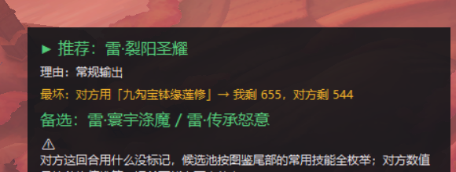

# 赛尔号「巅峰之战」战术辅助悬浮窗

> 实时看懂对局画面，用 max-min 博弈给出一手推荐。**只读屏幕：不读内存、不解析封包、不注入进程、不代打、不发按键。**



| 项 | 说明 |
| --- | --- |
| **技术栈** | Python 3 · RapidOCR + onnxruntime · ctypes/user32 抓屏 · tkinter 置顶悬浮窗 · SQLite · PyInstaller |
| **代码量** | 约 5,300 行 Python（30 个模块） |
| **数据规模** | 精灵 4,940 · 技能 27,044 · 技能归属 76,316 · 效果 2,193 · 魂印 2,151，全部从 BWIKI 解析落库 |
| **核心难点** | 没有官方接口 —— 局面、血量、用了哪一招，全靠截屏 + OCR + 像素反推 |
| **输出** | 悬浮窗三行：推荐动作 / 为什么 / 最坏情况（对方任意应对下我剩多少血） |

**这个项目想解决什么问题**：这类回合制对战的信息量全在画面上（血条没数字、
对方技能看不到、强化和回合效果要自己记），人脑算不过来。程序做的事是
**把画面变成结构化局面 → 枚举双方动作 → 算收益矩阵 → 取最坏情况最好的那一手**，
然后把理由摊开给人看，按键永远由玩家自己按。

---

看画面、算局势、给建议。**只看，不操作。**

## 硬约束（不会违反）

- 不读游戏内存、不解析封包、不注入进程。
- 不代打、不自动出招、不连点 —— **每一次按键都由玩家自己按**。
- 不留存对局数据：截图和对局日志退出即清，本地只保留精灵/技能资料库。

## 安装

Python 3.10+ 即可。国内网络建议加清华镜像（默认源下载 rapidocr 容易超时）：

```bash
python -m pip install -i https://pypi.tuna.tsinghua.edu.cn/simple rapidocr onnxruntime
```

其余依赖（requests / numpy / Pillow / tkinter）要么已有，要么是标准库。
**不用 PaddleOCR**：paddlepaddle 目前只到 cp312，且体积巨大；RapidOCR 走
onnxruntime，体积小得多，这种固定排版的截图识别效果完全够用。

## 用法

### 第一次：让程序记住游戏窗口

```bash
python main.py --pick
```

会列出当前所有窗口，输入游戏窗口前面的编号。选好后记在
`data/capture.json`，以后自动找它。

> 为什么必须手动选：浏览器标签页、本项目的对话窗口标题里也可能带
> "赛尔号" 三个字，按关键词自动认会认错窗口，所以不做自动匹配。

### 日常使用

```bash
python main.py
```

游戏开着、窗口别被完全遮挡，悬浮窗就会贴在画面上显示三行：

```
▶ 推荐：雷·裂阳圣耀          ← 建议的动作
理由：先手 +3，出手更快        ← 为什么
最坏：对方用「XXX」→ 我剩 655   ← 对方无论怎么出，最差到什么程度
```

**悬浮窗不抢焦点**，游戏照常收键。左键拖动挪位置，右键或 Esc 关掉。

| 热键 | 作用 |
|---|---|
| `F8` | 立即重算（画面没变时程序不会反复 OCR，按它强制刷新） |
| `F9` | 切换鼠标穿透（穿透后连点都透过去，悬浮窗变成纯显示） |

F8 是默认值，避开游戏自带的 F1。要改就改 `hotkey.py` 里的 `DEFAULT_KEY`。

### 不开悬浮窗、只在终端看

```bash
python main.py --no-ui
```

### 拿一张图跑一遍（调试用）

```bash
python main.py --image data/fake_battle.png
```

`tools/make_fake_battle.py` 能造一张和游戏排版相近的假截图，
在没有游戏可开的时候验证整条链路：

```bash
python tools/make_fake_battle.py        # 生成 data/fake_battle.png
python scene.py data/fake_battle.png    # 只看识别结果
```

## 文件说明

### 主链路

| 文件 | 作用 |
|---|---|
| `main.py` | 主程序：抓屏 → OCR → 局面 → 判断 → 悬浮窗 |
| `capture.py` | 找游戏窗口 + 截屏（ctypes 调 user32，无额外依赖） |
| `ocr.py` | RapidOCR 封装，输出 `[(文字, 置信度, x1, y1, x2, y2)]` |
| `scene.py` | 文字块 → 结构化局面（双方名字/血量/回合/技能格/飘字） |
| `hpbar.py` | 从血条像素读对方血量比例（画面不显示对方血量数字） |
| `overlay.py` | tkinter 悬浮窗，置顶半透明不抢焦点 |
| `hotkey.py` | 全局热键（user32，只读按键，不发送按键） |

### 判断与数据

| 文件 | 作用 |
|---|---|
| `repo.py` | 数据访问：模糊匹配精灵/技能、取常用技能、面板与满血 |
| `rules.py` | 规则常数：能力等级换算、本系加成、属性克制合并 |
| `damage.py` | 伤害公式与浮动区间 |
| `effects.py` | 技能/魂印效果文本 → 结构化要点（增伤、威力加成、先制、控场、回合类效果…） |
| `turnstate.py` | 跨回合状态：靠 PP 递减自动认出你用了哪招，跟踪强化等级与回合类效果 |
| `decide.py` | 判断引擎：双方动作枚举 → 收益矩阵 → max-min 稳健推荐 |
| `paths.py` | 路径解析：源码运行和打包成 exe 之后都能找到数据 |

### 跨回合状态是怎么跟的

引擎原来只看得懂「这一帧」，但强化和「4回合内免疫」这类效果是跨回合的。
办法是**不额外操作也能知道用了哪招**：

- **主信号：PP 递减**。底部技能格的「次数 x/y」是明文数字，你用了哪招，
  它的 PP 就少 1。程序每帧记一次快照，发现哪招的 PP 掉了就认定是它。
- **辅信号：选中态**。左下的圆形面板显示你当前点选/悬停的技能名。
  它比 PP 早一拍（你先点技能再点战斗），用于消歧；
  但只有悬停时才显示，所以不能单靠它。

认出来之后，把那招的回合类效果登记成持续状态、把强化折成能力等级
（`(x+2)/2` 与 `2/(2+x)`，上限 ±6），下一回合继续衰减。
同名效果重复使用是**刷新**而不是叠加。
**对方的技能看不到**，所以对方的回合类效果只能手动登记，程序不猜。

### 打包成 exe（发给别人用）

```
python -m pip install -i https://pypi.tuna.tsinghua.edu.cn/simple pyinstaller
python -m PyInstaller build.spec --noconfirm --distpath dist --workpath build
```

产物 `dist/SeerHelper.exe` 单文件、自带 Python、自带精灵库，约 **105 MB**。
打包产物和 `data/seer.db` 都不入库（见 `.gitignore`），需要时本地重新构建。

打包踩过的坑，改 spec 时别踩回去：

- **spec 文件里没有 `__file__`**，要用 PyInstaller 注入的 `SPECPATH`。
- **200MB 的包要先减肥**。第一次打出来 203MB，因为被连带拖进了
  `pyarrow`(81MB)、`faiss`(74MB)、`tokenizers`、`hf_xet`、`pydantic_core`、
  torch 的元数据等一共约 177MB 我们一行都不用的东西 ——
  靠 `excludes` 列表挡掉。另外又从打包清单里按文件名剔了
  `cv2/opencv_videoio_ffmpeg*.dll`（31MB 视频编解码器）和
  `PIL/_avif`、`PIL/_webp`（7.8MB 图片编解码器，游戏截图用不到）。
  用 `python tools05_size.py` 可以看当前包里谁最占体积。
- **别开 UPX**：会把 onnxruntime 的 DLL 压坏。
- **`console=True` 要留着**：`--pick` 选窗口要在终端里输编号。
- 数据路径走 `paths.resource()`：exe 旁边的文件优先，没有才用打包进去的。
  所以想把精灵库换成新版，直接往 exe 旁边放一份 `data/seer.db` 就行。

### 建库

> 仓库**不包含** `data/seer.db`（12 MB 生成物）。首次使用先跑一次抓取建库，
> 大约几分钟；之后只有游戏更新精灵时才需要重建。

| 文件 | 作用 |
|---|---|
| `wiki_client.py` / `ingest.py` | 从赛尔号 BWIKI 抓精灵与技能落库 |
| `parse_wikitext.py` | 解析 `{{精灵|...}}` / `{{技能|...}}` 模板 |
| `parse_lua_coef.py` | 解析 `模块:属性克制` Lua 表 → `data/coef.json` |
| `check_data.py` / `verify_damage.py` / `e2e_check.py` | 数据体检与公式自检 |

数据库在 `data/seer.db`：精灵 4940、技能 27044、技能归属 76316、
效果 2193、魂印 2151。

## 数据出处

规则和公式都来自赛尔号 BWIKI，不是猜的：

- 伤害公式 → `赛尔号PVE概论` 页「红伤计算公式」
- 能力等级/克制合并/异常状态 → `对战机制` 页
- 面板公式 → `培养机制` 页
- 属性克制系数 → `模块:属性克制` / `模块:属性克制1`

## 已知不足

- **对方数值靠推算**：画面只给血条比例，不给数字。程序用
  「我方实测满血 ÷ 我方裸面板」标定这一局的装备强度，再套到对方身上，
  误差可能有上百点体力。
- **对方出招未标记**：对方用了什么要点开才看得见，OCR 不现实。
  程序按图鉴尾部的常用技能全枚举，结果偏保守。
- **伤害有个整体校准系数 K**：目前只有一个实战锚点（截图里的「克制-285」），
  区间偏宽，需要更多实战数据收紧。
- **跨回合跟踪从开局起才准**：PP 递减要有一帧基线，程序启动时如果已经打到
  第 N 回合，前 N 回合的强化它不知道；而且底部技能格读错一个字就会认错招。
- **属性技的收益权重是估的**：把「全属性+1」折算成「约等于造成多少伤害」时
  用的权重（攻 0.30 / 防 0.20 / 控场 0.45…）是拍的，不是实测数据，可调。
- 游戏窗口被完全遮挡时抓不到画面（用的是普通抓屏，不是 GPU 抓取）。
